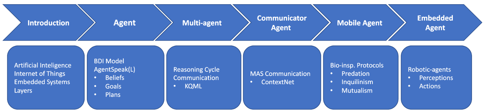

# Introduction to Distributed and Embedded Artificial Intelligence

An Embedded Multi-Agent System (MAS) is a computational system embedded in a device that operates in a real-world environment, controls and monitors the hardware, executes physical actions, and allows external communication with other embedded systems. The development of an Embedded MAS is a difficult task, as it requires knowledge and concepts from different areas, such as electronics (sensors and actuators), low-level programming, object-oriented programming, and, finally, agent-oriented programming, where the MAS is accountable for cognition, autonomy, social interaction (with other devices, systems, or humans) and decision-making. In this course, we explore a toolkit for teaching and developing Distributed Artificial Intelligence (DAI) systems using Embedded MAS and also show the benefits of using a spin-off version of Jason specific for embedded agents. This toolkit provides a do-it-yourself approach containing methods, software, teaching materials, hardware schematics, and codes for experiments in practical and simulated embedded BDI agents. It intends to support academics and professionals in the device’s design by following a five-layer architecture, where they must interfere to build proactive, social, and autonomous devices. The developed MAS can manage the hardware and communicate using an existing network to exchange messages and move agents between systems. This work resignifies the Multi-Agent Oriented Programming (MAOP) by considering Open MAS and extended communication abilities, consolidating Embedded MAS as a promising approach for integrating distributed AI and hardware in the real world using BDI agents programmed in Jason. Besides, it also shows how to emulate devices and hardware components using serial communication to communicate with existing simulators and provide a testable instance before the system deployment.

In this course, students will: 

+ to understand how to use a specialized version of the Jason Framework for embedded systems; 

+ to use an integrated development environment to program the firmware and reasoning layers of cognitive devices; 

+ to know about a specific-purpose operating system for embedded multi-agent systems; and finally, 

+ to access an IoT network to allow communication between autonomous agents and cognitive hardware.

## Content

+ Introduction
+ [Single-agent System](02-Single-agentSystem#02---single-agent-systems)
+ [Multi-agent System](03-Multi-agentSystem#03---multi-agent-systems)
+ [Communicator Agent](04-LimitedOpenMAS#04---communicator-agent)
+ [Mobile Agent](05-OpenMAS#05---mobile-agent)
+ Embedded Agent

## Copyright
 This course is licensed under a <a rel="license" href="http://creativecommons.org/licenses/by/4.0/">Creative Commons Attribution 4.0 International License</a>. The licensor cannot revoke these freedoms as long as you follow the license terms:

* __Attribution__ — You must give __appropriate credit__ like below:

LAZARIN, Nilson Mori; PANTOJA, Carlos Eduardo; VITERBO, José. Towards a Toolkit for Teaching AI Supported by Robotic-agents: Proposal and First Impressions. _In:_ WORKSHOP SOBRE EDUCAÇÃO EM COMPUTAÇÃO (WEI), 31. , 2023, João Pessoa/PB. Anais [...]. Porto Alegre: Sociedade Brasileira de Computação, 2023 . p. 20-29. ISSN 2595-6175. DOI: https://doi.org/10.5753/wei.2023.229753. 
